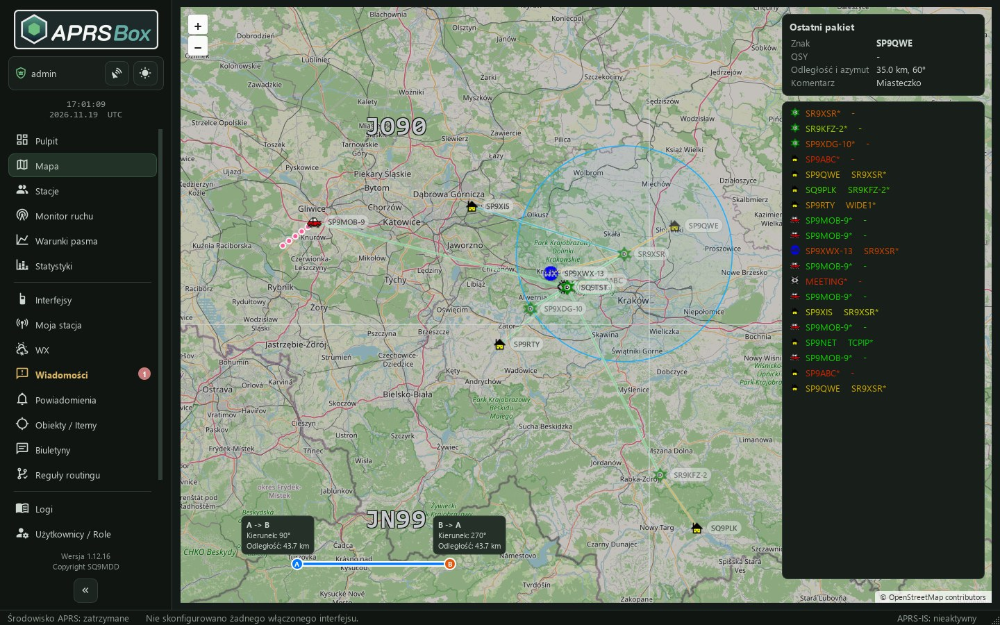
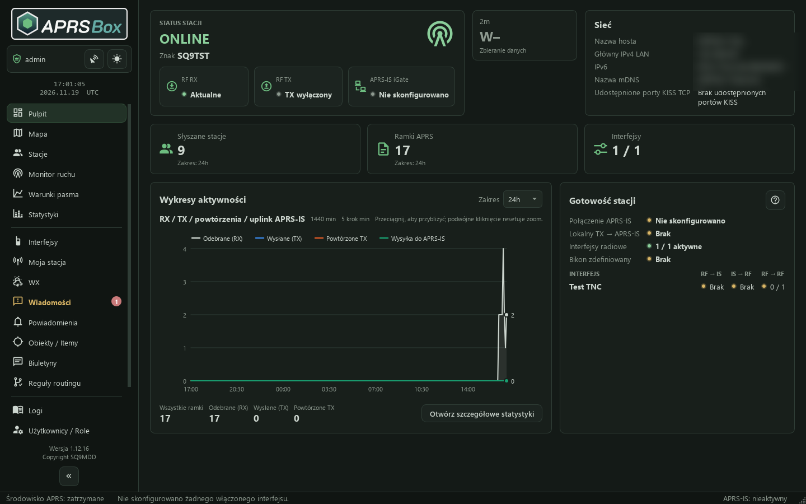
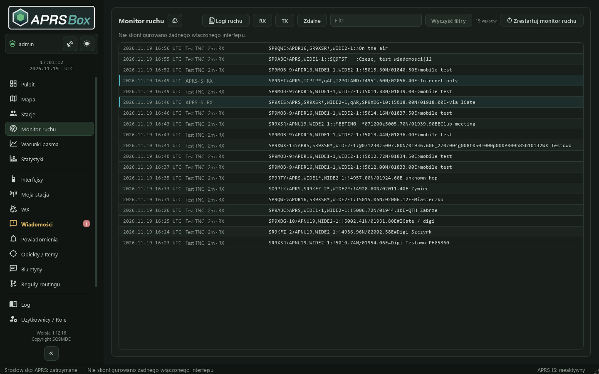
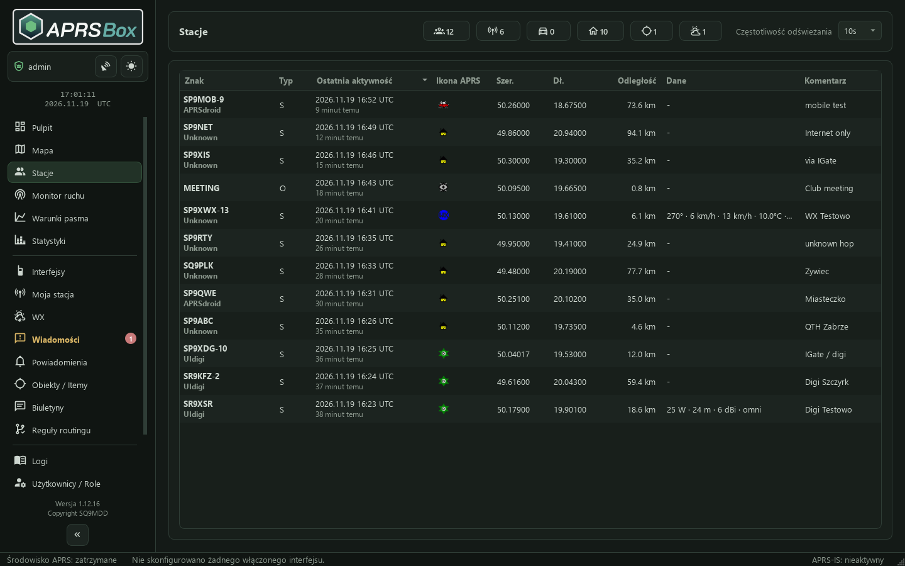
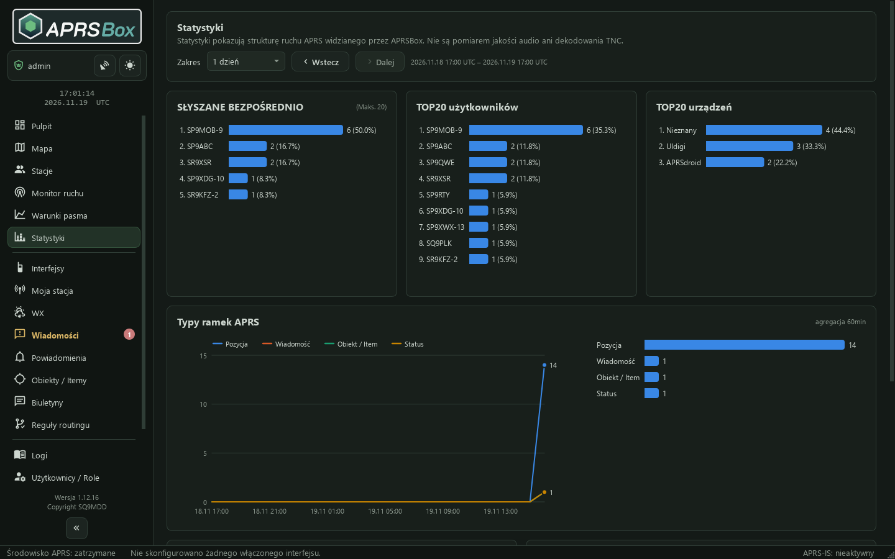
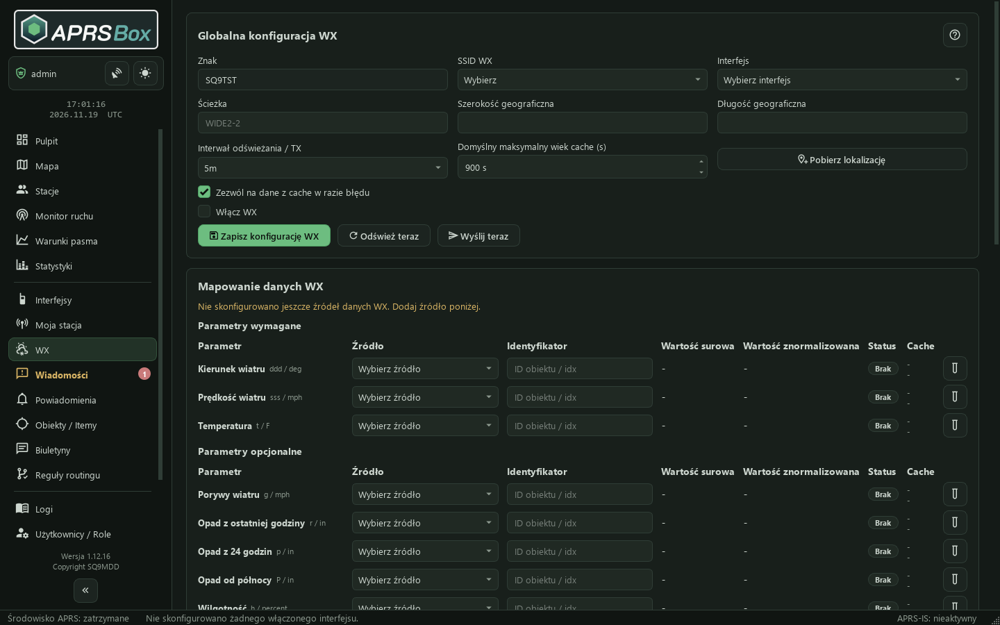
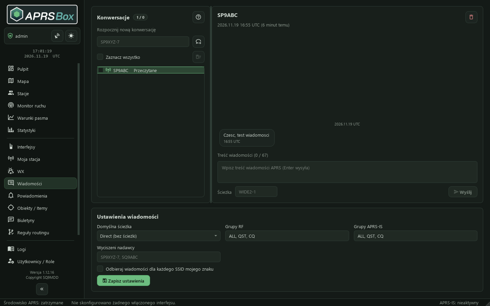
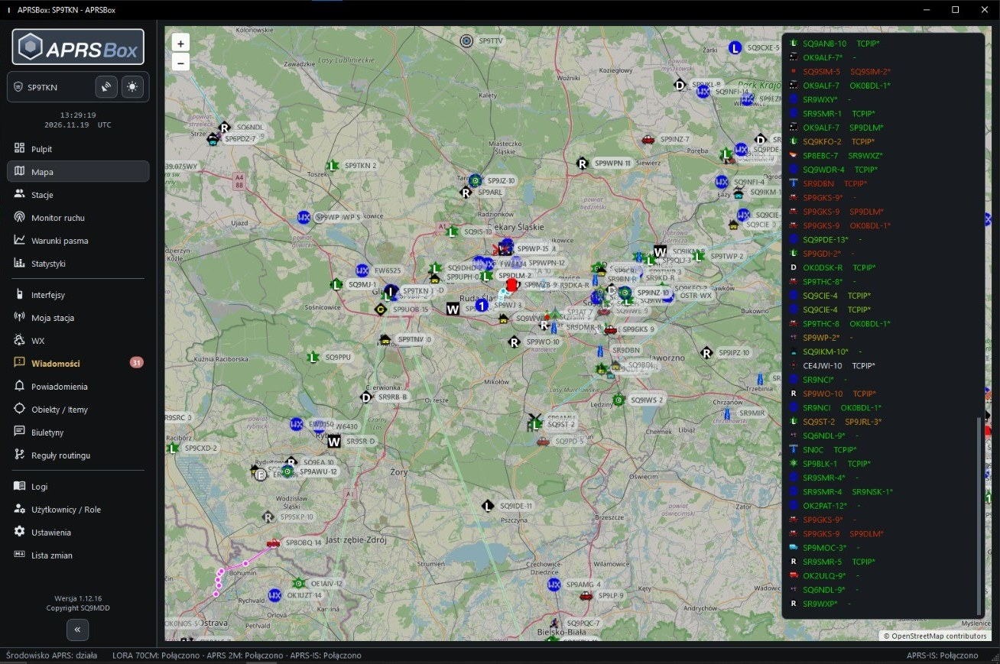
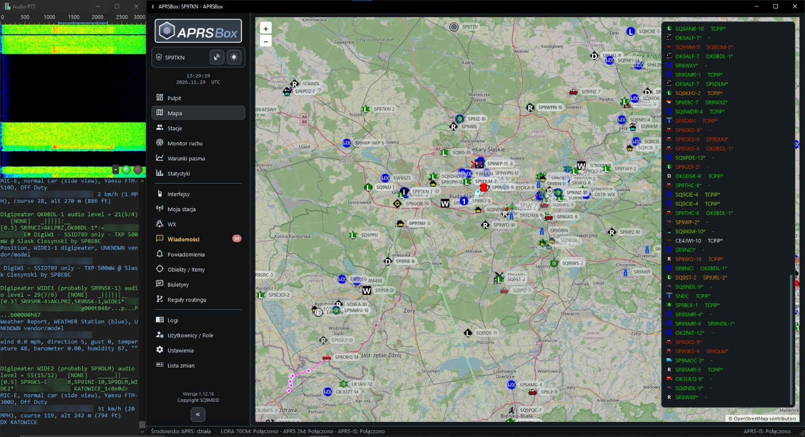
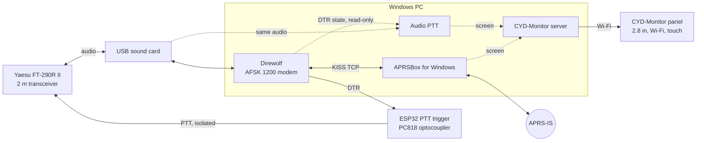

# APRSBox for Windows — SP9TKN port

> 🇵🇱 Polish version: [README.pl.md](README.pl.md)

<!-- ecosystem-link:aprs -->
📡 Part of the **SP9TKN APRS station** — see [how the pieces work together](#part-of-the-sp9tkn-aprs-station).

> [!NOTE]
> **This is a fork of [APRSBox](https://github.com/SQ9MDD/APRSBox) by SQ9MDD.**
> **The original is a Linux application** — for Raspberry Pi and Linux servers, with a **web panel** in the browser
> (FastAPI), Docker images and systemd / OpenRC installers. Its README is kept as
> **[README.aprsbox.md](README.aprsbox.md)**.
> **This fork is a native Windows desktop program:** the same APRS service code, but a normal Windows window
> (PySide6 / Qt) instead of the web panel, a portable package with Python inside, and **additional changes** — a
> native map with RF paths, an offline tile cache and extra base maps, CWOP weather stations, weather history charts,
> Windows serial ports, tray and autostart, and a series of reliability fixes.

> [!IMPORTANT]
> **🇵🇱 The program is in Polish** (the window texts are translated to Polish). Detailed usage notes in Polish:
> [README-WINDOWS.md](README-WINDOWS.md).

<p align="center">
  
</p>
<p align="center"><sub>The native map: stations with APRS symbols, RF paths ("who heard whom through which digipeater"), range
circle, Maidenhead grid, distance tool and the list of the last frames. Rendered off-screen from simulated traffic with
fictitious callsigns (<code>scripts/desktop_screenshots.py</code>).</sub></p>

## Linux original vs Windows port

| | APRSBox (SQ9MDD) | APRSBox for Windows (this fork) |
|---|---|---|
| System | Linux, Raspberry Pi, Docker | **Windows 10 / 11, 64-bit** |
| User interface | web panel in a browser, login | **native window** (PySide6 / Qt) with all the pages and sub-pages, tray icon, autostart |
| Installation | install script / Docker image | **portable ZIP** with Python 3.13 inside, or a venv from source |
| APRS logic | `app.core_main` runtime + `app.main` web app | the same services, running inside the window's process |
| Serial KISS TNC | POSIX `termios` / `select` | a pyserial backend: `COM3`, `\\.\COM12`, `socket://host:port`, `loop://` |

**Added or changed in this fork:**

- **Native map** — map sources from the settings, disk cache of tiles (areas already seen work offline, size limit
  1 GB), base map switcher on the toolbar, base map brightening (+10…+50 %), "super zoom" past the source's maximum,
  an elevation map (AWS terrain), seamless tiles.
- **RF paths on the map** — like APRSIS32: for every heard frame the line goes source → digipeaters (WIDE1, WIDE2 …)
  → your station; frames from APRS-IS are drawn to the IGate that heard them (qAR/qAO); time window and RF / APRS-IS
  filters next to the button.
- **Station details on the map** — information after a click, the station card after a double click, time of
  reception over RF and over APRS-IS, all frames from the retention period.
- **CWOP weather stations** on the map — a read-only client of `cwop.aprs.net` with a range filter around your station
  (APRS-IS never carries them).
- **Weather history** — every weather report heard over RF, APRS-IS or CWOP kept for 7 days in metric units, with
  charts on the station card.
- **Windows integration** — the taskbar / tray icon is your own APRS symbol, start minimised, autostart without admin
  rights, a sound for EMERGENCY / alert pop-ups, slower refreshes when nobody uses the PC.
- **Digipeater** — frames with Polish letters and emoji are digipeated.
- **Reliability** — the background loops (transmit queue, beacon, object, bulletin, WX schedulers) survive a database
  error instead of stopping silently; a Qt crash (signals through deleted objects, garbage collection on worker threads)
  removed; memory leaks in background tasks and the map fixed; warnings and errors kept in the event log for 30 days.
- **Tests** — window tests run without a display (`QT_QPA_PLATFORM=offscreen`) on a temporary database with simulated
  traffic; an end-to-end test runs the real runtime against a fake KISS TNC and a fake APRS-IS server on localhost.

Every change is described, newest first, in [CHANGES-WINDOWS.pl.txt](CHANGES-WINDOWS.pl.txt) (Polish).

## Screenshots

<table>
  <tr>
    <td><br><sub>Dashboard: station status, activity charts, station readiness</sub></td>
    <td><br><sub>Traffic monitor: RF and APRS-IS frames, filters</sub></td>
  </tr>
  <tr>
    <td><br><sub>Stations: type, last activity, APRS icon, position, distance</sub></td>
    <td><br><sub>Statistics</sub></td>
  </tr>
  <tr>
    <td><br><sub>WX: own weather beacon configuration and data sources</sub></td>
    <td><br><sub>Band condition</sub></td>
  </tr>
</table>
<p align="center"><sub>Rendered off-screen from simulated traffic with fictitious callsigns; host network details on the dashboard are
blurred.</sub></p>

<p align="center">
  
</p>
<p align="center"><sub>At the real station: APRSBox with the map and the list of heard stations, next to Audio PTT and Direwolf.</sub></p>

## Installation

**Portable package (simplest):** download `APRSBox-windows_….zip` from
[Releases](https://github.com/SP9TKN/APRSBox/releases), open its **Properties** and tick **Unblock**, unpack it to a
folder you can write to (Desktop, Documents, `C:\APRS\` — not `C:\Program Files`) and run **`APRSBox.exe`**. Python 3.13
and all libraries are inside; nothing is installed. The station data stays in the program folder (`data\`, `logs\`,
`config\`, `backups\`); the package contains none.

**From source** (Python 3.13 for Windows):

```bat
py -3.13 -m venv .venv
.venv\Scripts\python -m pip install -r requirements-desktop.txt
.venv\Scripts\pythonw.exe APRSBox.pyw
```

`APRSBox.exe` is only a small launcher (`launcher\APRSBox.cs`, built with `launcher\build.cmd`) that starts
`APRSBox.pyw` with `.venv` or the bundled `python\` without a console window. Options: `--minimized`, `--no-runtime`
(window only, no interfaces and no transmitting), `--page NAME` (e.g. `map`, `traffic`, `messages`).

**First start:** *My station* (callsign, SSID, position, symbol, path, beacon interval; transmit is off by default) →
*Interfaces*: KISS TCP (e.g. Direwolf `127.0.0.1:8100`), KISS over a serial port (`COM5`), APRS-IS (the passcode is
computed from the callsign), OpenWebRX MQTT (receive only) → only then enable TX and the routing rules (digipeater).
Details: [README-WINDOWS.md](README-WINDOWS.md).

## Station scripts (`windows-station/`)

The scripts that keep the SP9TKN station running unattended:

| Script | What it does |
|---|---|
| `start-aprsbox` / `stop-aprsbox` | starts the station in order (Direwolf → Audio PTT → APRSBox) and places the windows / stops it and pauses the watchdog |
| `start-watchdog` / `stop-watchdog` | the scheduled task "APRSBox-Watchdog": every 30 s it starts whatever stopped, every 5 s it puts the windows back where `layout.json` says (after a monitor sleep, a KVM switch, a resolution change) |
| `edit-layout` / `save-layout` / `fix-layout` | arrange the windows by hand (the watchdog waits up to 15 min) and save the layout / restore it now |

They expect the station layout next to APRSBox: [Direwolf](https://github.com/SP9TKN/direwolf) in
`direwolf-1.8.1-aprsbox290r2\…\direwolf.exe` and [Audio PTT](https://github.com/SP9TKN/audio-ptt) in
`Audio PTT\AudioPTT.exe`. The programs are started through WMI, so stopping the scheduled task never takes the station
down with it.

## Tests

```bat
.venv\Scripts\python -m pip install -r requirements-dev-windows.txt
.venv\Scripts\python -m pytest
```

Page screenshots without a display:
`.venv\Scripts\python scripts\desktop_screenshots.py C:\Temp\shots dashboard map traffic --tiles --paths`.

<!-- ecosystem:aprs:start -->

## Part of the SP9TKN APRS station

Five projects work together as one APRS station on a Windows PC with a Yaesu FT-290R II (2 m). Each part does one job and also works on its own.

| Project | Role |
|---|---|
| [ESP32 PTT trigger](https://github.com/SP9TKN/esp32-ptt-pc818) | keys the radio's PTT through a PC818 optocoupler (galvanic isolation), red/green TX/RX LEDs |
| [Audio PTT](https://github.com/SP9TKN/audio-ptt) | radio audio as a UZ7HO-style waterfall + PTT lamps, read-only |
| [APRSBox for Windows](https://github.com/SP9TKN/APRSBox) **← you are here** | the APRS application: iGate, digipeater, beacons, messages, map (Windows port of SQ9MDD's APRSBox) |
| [CYD-Monitor](https://github.com/SP9TKN/cyd-monitor) | 2.8" ESP32 display as a wireless monitor: the station screen over Wi-Fi, with touch |
| [Direwolf — SP9TKN package](https://github.com/SP9TKN/direwolf) | sound-card modem / TNC (AFSK 1200): WB2OSZ's Direwolf 1.8.1 with a dark console window and the station configuration (PTT on DTR, KISS TCP for APRSBox) |


*The station at work: Audio PTT (top left), Direwolf (bottom left) and APRSBox with the map. Coordinates of other stations in the Direwolf window are blurred.*



**How it works**

1. **Receive.** Audio from the FT-290R II goes through a USB sound card to **Direwolf**, which decodes the AFSK 1200
   packets and hands them to **APRSBox** over KISS TCP. APRSBox stores them, draws them on the map, gates them to
   APRS-IS and digipeats them according to its routing rules.
2. **Transmit.** APRSBox queues a beacon, a message or a frame to digipeat and passes it to Direwolf over KISS.
   Direwolf raises **DTR** on the USB serial port of the **ESP32 PTT trigger** (`PTT COMx DTR`); the board closes the
   radio's PTT through the PC818 optocoupler and lights the red LED, and Direwolf plays the packet audio.
3. **Watch.** **Audio PTT** shows the same radio audio as a waterfall, with two lamps that follow the PTT line. It
   reads the DTR state from the port Direwolf holds, without opening the port, so it never gets in the way of
   transmitting.
4. **From any room.** **CYD-Monitor** mirrors the station desktop (APRSBox map, Audio PTT, Direwolf log) to a 2.8"
   ESP32 "Cheap Yellow Display" over Wi-Fi. The same panel is also the display of the
   [SP9TKN SDR scanner](https://github.com/SP9TKN/cyd-monitor#part-of-the-sp9tkn-sdr-scanner): it jumps to the scanner page when SDR Oxide hears something.
5. **Unattended.** Watchdog scripts (in the APRSBox repository) restart any program that stops and put the windows
   back in place after the monitor sleeps; a virtual display keeps the desktop at 1920×1080 while the physical
   monitor is off.

<!-- ecosystem:aprs:end -->

## License

[GPL-3.0](LICENSE), the same as the original. APRSBox © SQ9MDD; the Windows port © 2026 SP9TKN.

**Tools:** the Windows port was developed with [Claude Code](https://claude.com/claude-code) (Anthropic) — AI assistant
used for coding, testing and documentation.
