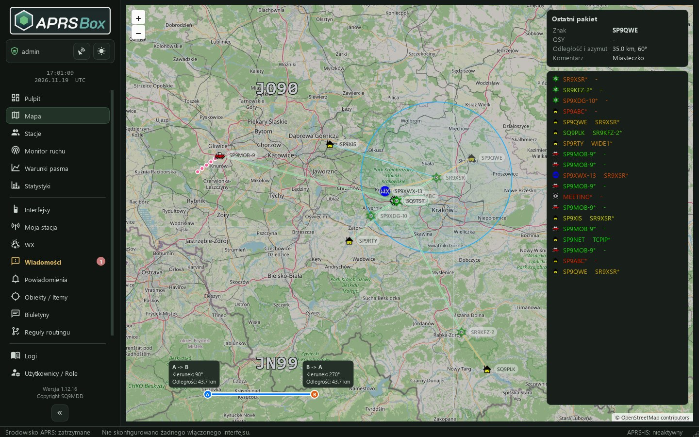
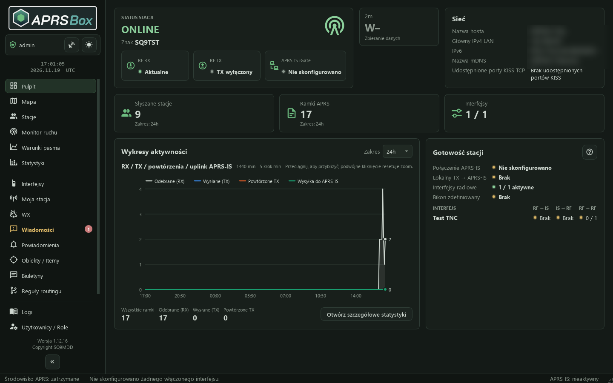
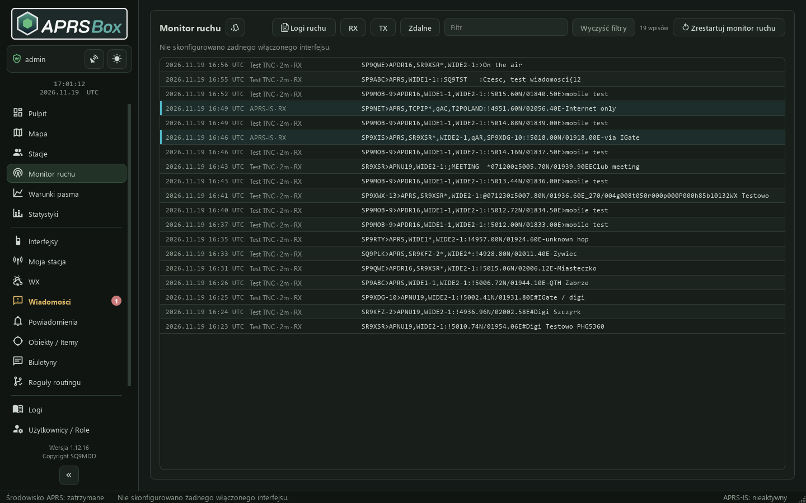
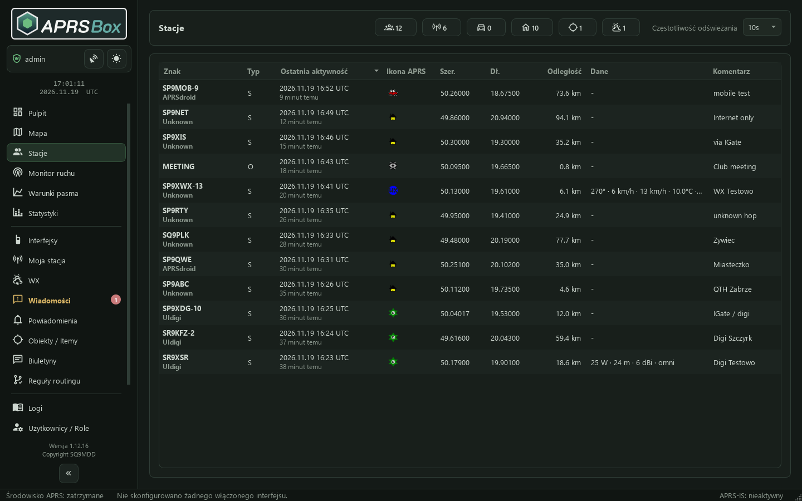
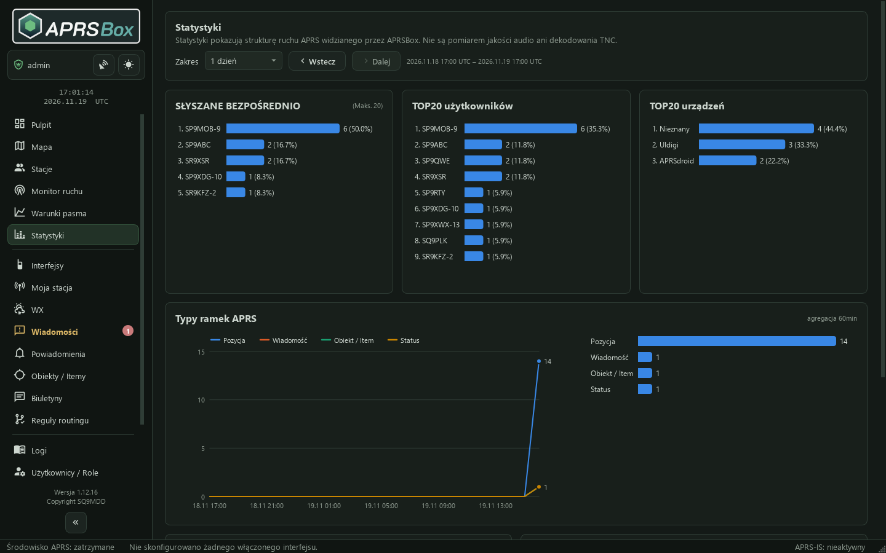
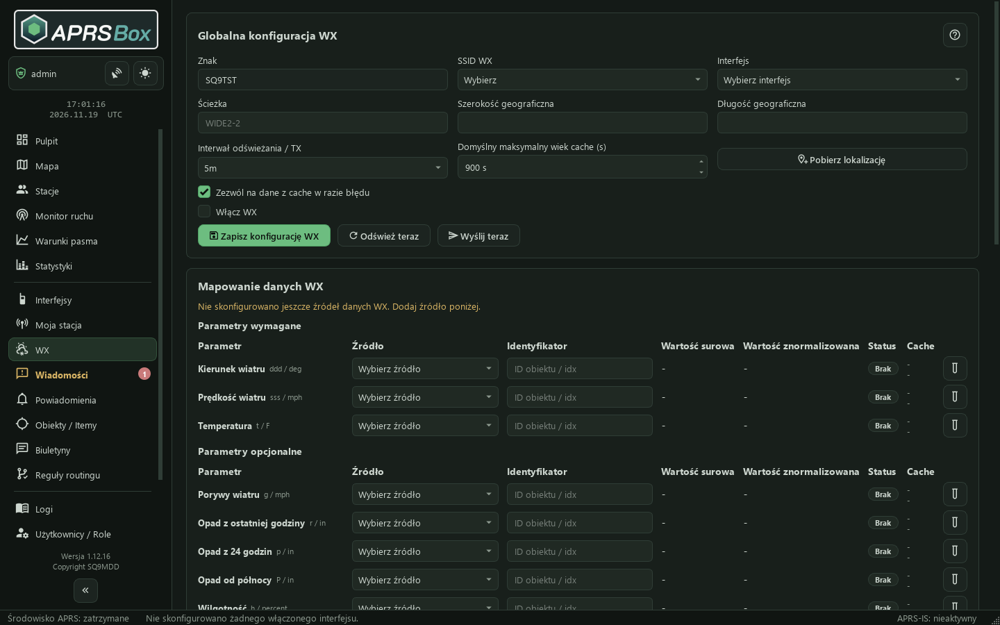
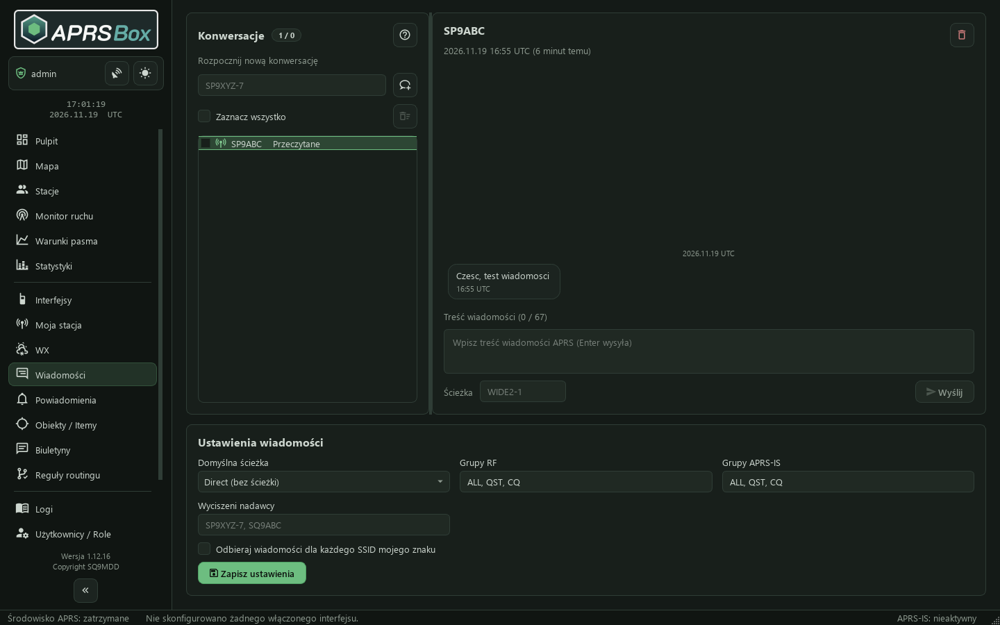
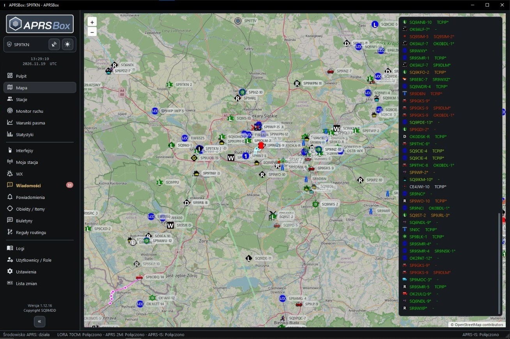
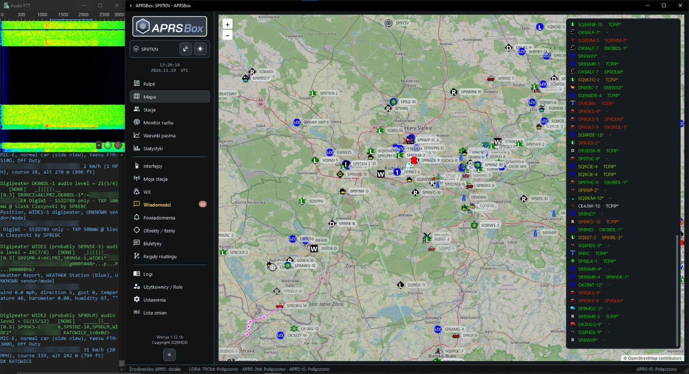
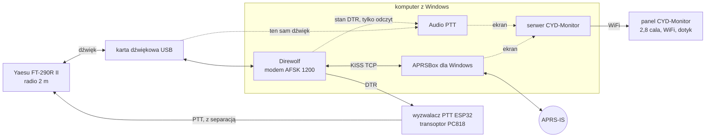

# APRSBox dla Windows — port SP9TKN

> 🇬🇧 English version: [README.md](README.md)

<!-- ecosystem-link:aprs -->
📡 Część **stacji APRS SP9TKN** — zobacz, [jak elementy działają razem](#część-stacji-aprs-sp9tkn).

> [!NOTE]
> **To fork programu [APRSBox](https://github.com/SQ9MDD/APRSBox) autorstwa SQ9MDD.**
> **Oryginał to aplikacja na Linuksa** — dla Raspberry Pi i serwerów z Linuksem, z **panelem WWW** w przeglądarce
> (FastAPI), obrazem Dockera i instalatorami systemd / OpenRC. Jego README jest w pliku
> **[README.aprsbox.md](README.aprsbox.md)**.
> **Ten fork to natywny program dla Windows:** ten sam kod usług APRS, ale zwykłe okno Windows (PySide6 / Qt) zamiast
> panelu WWW, przenośna paczka z Pythonem w środku i **dodatkowe zmiany** — natywna mapa ze ścieżkami RF, kopia
> kafelków do pracy bez sieci i dodatkowe podkłady, stacje pogodowe CWOP, wykresy historii pogody, porty szeregowe
> Windows, zasobnik i autostart oraz seria poprawek niezawodności.

Szczegółowa instrukcja obsługi: [README-WINDOWS.md](README-WINDOWS.md).

<p align="center">
  
</p>
<p align="center"><sub>Natywna mapa: stacje z symbolami APRS, ścieżki RF („kto kogo słyszy przez który digipeater”), okrąg zasięgu,
siatka lokatorów, pomiar odległości i lista ostatnich ramek. Obraz wygenerowany bez ekranu z symulowanego ruchu
z fikcyjnymi znakami (<code>scripts/desktop_screenshots.py</code>).</sub></p>

## Oryginał na Linuksa a port na Windows

| | APRSBox (SQ9MDD) | APRSBox dla Windows (ten fork) |
|---|---|---|
| System | Linux, Raspberry Pi, Docker | **Windows 10 / 11, 64-bit** |
| Interfejs | panel WWW w przeglądarce, logowanie | **natywne okno** (PySide6 / Qt) ze wszystkimi stronami i podstronami, ikona w zasobniku, autostart |
| Instalacja | skrypt instalacyjny / obraz Dockera | **przenośny ZIP** z Pythonem 3.13 w środku albo venv ze źródeł |
| Logika APRS | runtime `app.core_main` + aplikacja WWW `app.main` | te same usługi, działające w procesie okna |
| TNC KISS na porcie szeregowym | POSIX `termios` / `select` | obsługa przez pyserial: `COM3`, `\\.\COM12`, `socket://host:port`, `loop://` |

**Dodane albo zmienione w tym forku:**

- **Natywna mapa** — źródła map z ustawień, kopia kafelków na dysku (oglądane obszary działają bez sieci, limit
  1 GB), przełącznik podkładu na pasku, rozjaśnianie podkładu (+10…+50 %), „super zoom” ponad maksimum źródła, mapa
  wysokości (AWS), kafelki bez linii na styku.
- **Ścieżki RF na mapie** — jak w APRSIS32: dla każdej usłyszanej ramki linia stacja → digipeatery (WIDE1, WIDE2 …) →
  Twoja stacja; ramki z APRS-IS rysowane do IGate'a, który je usłyszał (qAR/qAO); okno czasowe i filtry RF / APRS-IS
  obok przycisku.
- **Informacje o stacji na mapie** — po kliknięciu dymek, po dwukliku karta stacji, czas odbioru przez radio i przez
  APRS-IS, wszystkie ramki z okresu retencji.
- **Stacje pogodowe CWOP** na mapie — klient `cwop.aprs.net` tylko do odbioru, z filtrem zasięgu wokół Twojej stacji
  (APRS-IS ich nie przenosi).
- **Historia pogody** — każdy raport pogodowy usłyszany przez radio, APRS-IS albo CWOP trzymany 7 dni w jednostkach
  metrycznych, z wykresami na karcie stacji.
- **Integracja z Windows** — ikona na pasku zadań i w zasobniku to symbol APRS Twojej stacji, start zminimalizowany,
  autostart bez uprawnień administratora, dźwięk przy oknach EMERGENCY / alarmów, rzadsze odświeżanie, gdy nikt nie
  używa komputera.
- **Digipeater** — ramki z polskimi literami i emoji są powtarzane.
- **Niezawodność** — pętle w tle (kolejka nadawania, planery beaconów, obiektów, biuletynów, WX) przeżywają błąd bazy,
  zamiast cicho stanąć; usunięta przyczyna awarii Qt (sygnały przez usunięte obiekty, sprzątanie pamięci w wątkach
  roboczych); naprawione wycieki pamięci zadań w tle i mapy; ostrzeżenia i błędy w dzienniku zdarzeń trzymane 30 dni.
- **Testy** — testy okna działają bez ekranu (`QT_QPA_PLATFORM=offscreen`) na tymczasowej bazie z symulowanym ruchem;
  test end-to-end uruchamia prawdziwy runtime z fałszywym TNC KISS i fałszywym serwerem APRS-IS na localhost.

Każda zmiana jest opisana, najnowsze na górze, w [CHANGES-WINDOWS.pl.txt](CHANGES-WINDOWS.pl.txt).

## Zrzuty ekranu

<table>
  <tr>
    <td><br><sub>Pulpit: status stacji, wykresy aktywności, gotowość stacji</sub></td>
    <td><br><sub>Monitor ruchu: ramki z radia i APRS-IS, filtry</sub></td>
  </tr>
  <tr>
    <td><br><sub>Stacje: typ, ostatnia aktywność, ikona APRS, pozycja, odległość</sub></td>
    <td><br><sub>Statystyki</sub></td>
  </tr>
  <tr>
    <td><br><sub>WX: konfiguracja własnego beaconu pogodowego i źródeł danych</sub></td>
    <td><br><sub>Warunki pasma</sub></td>
  </tr>
</table>
<p align="center"><sub>Obrazy wygenerowane bez ekranu z symulowanego ruchu z fikcyjnymi znakami; dane sieciowe komputera na pulpicie
są zamazane.</sub></p>

<p align="center">
  
</p>
<p align="center"><sub>Na prawdziwej stacji: APRSBox z mapą i listą usłyszanych stacji, obok Audio PTT i Direwolfa.</sub></p>

## Instalacja

**Paczka przenośna (najprościej):** pobierz `APRSBox-windows_….zip` z
[Releases](https://github.com/SP9TKN/APRSBox/releases), otwórz jego **Właściwości** i zaznacz **Odblokuj**, rozpakuj do
folderu, w którym masz prawo zapisu (Pulpit, Dokumenty, `C:\APRS\` — nie `C:\Program Files`), i uruchom
**`APRSBox.exe`**. Python 3.13 i wszystkie biblioteki są w środku; niczego się nie instaluje. Dane stacji zostają
w folderze programu (`data\`, `logs\`, `config\`, `backups\`); paczka żadnych nie zawiera.

**Ze źródeł** (Python 3.13 dla Windows):

```bat
py -3.13 -m venv .venv
.venv\Scripts\python -m pip install -r requirements-desktop.txt
.venv\Scripts\pythonw.exe APRSBox.pyw
```

`APRSBox.exe` to tylko mały starter (`launcher\APRSBox.cs`, budowany przez `launcher\build.cmd`), który uruchamia
`APRSBox.pyw` z `.venv` albo z dołączonego folderu `python\`, bez okna konsoli. Opcje: `--minimized`, `--no-runtime`
(samo okno, bez interfejsów i nadawania), `--page NAZWA` (np. `map`, `traffic`, `messages`).

**Pierwsze uruchomienie:** *Moja stacja* (znak, SSID, pozycja, symbol, ścieżka, interwał beaconu; nadawanie domyślnie
wyłączone) → *Interfejsy*: KISS TCP (np. Direwolf `127.0.0.1:8100`), KISS przez port szeregowy (`COM5`), APRS-IS
(passcode liczy się ze znaku), OpenWebRX MQTT (tylko odbiór) → dopiero potem TX i reguły routingu (digipeater).
Szczegóły: [README-WINDOWS.md](README-WINDOWS.md).

## Skrypty stacji (`windows-station/`)

Skrypty, dzięki którym stacja SP9TKN działa bez nadzoru:

| Skrypt | Co robi |
|---|---|
| `start-aprsbox` / `stop-aprsbox` | uruchamia stację po kolei (Direwolf → Audio PTT → APRSBox) i ustawia okna / zatrzymuje ją i wstrzymuje watchdoga |
| `start-watchdog` / `stop-watchdog` | zadanie „APRSBox-Watchdog”: co 30 s uruchamia to, co stanęło, co 5 s odstawia okna tam, gdzie mówi `layout.json` (po uśpieniu monitora, przełączniku KVM, zmianie rozdzielczości) |
| `edit-layout` / `save-layout` / `fix-layout` | ręczne ułożenie okien (watchdog czeka do 15 min) i zapis układu / przywrócenie go od razu |

Skrypty oczekują układu stacji obok APRSBox: [Direwolf](https://github.com/SP9TKN/direwolf) w
`direwolf-1.8.1-aprsbox290r2\…\direwolf.exe` i [Audio PTT](https://github.com/SP9TKN/audio-ptt) w
`Audio PTT\AudioPTT.exe`. Programy startują przez WMI, więc zatrzymanie zadania nigdy nie wyłącza z nim stacji.

## Testy

```bat
.venv\Scripts\python -m pip install -r requirements-dev-windows.txt
.venv\Scripts\python -m pytest
```

Zrzuty stron bez ekranu:
`.venv\Scripts\python scripts\desktop_screenshots.py C:\Temp\shots dashboard map traffic --tiles --paths`.

<!-- ecosystem:aprs:start -->

## Część stacji APRS SP9TKN

Pięć projektów działa razem jako jedna stacja APRS na komputerze z Windows i radiu Yaesu FT-290R II (2 m). Każda część robi jedną rzecz i działa też osobno.

| Projekt | Rola |
|---|---|
| [Wyzwalacz PTT ESP32](https://github.com/SP9TKN/esp32-ptt-pc818) | kluczuje PTT radia przez transoptor PC818 (separacja galwaniczna), diody TX/RX |
| [Audio PTT](https://github.com/SP9TKN/audio-ptt) | dźwięk z radia jako wodospad jak w UZ7HO + lampki PTT, tylko odczyt |
| [APRSBox dla Windows](https://github.com/SP9TKN/APRSBox) **← tu jesteś** | program APRS: iGate, digipeater, beacony, wiadomości, mapa (port APRSBox SQ9MDD na Windows) |
| [CYD-Monitor](https://github.com/SP9TKN/cyd-monitor) | wyświetlacz ESP32 2,8" jako monitor bezprzewodowy: ekran stacji przez WiFi, z dotykiem |
| [Direwolf — paczka SP9TKN](https://github.com/SP9TKN/direwolf) | modem / TNC na karcie dźwiękowej (AFSK 1200): Direwolf 1.8.1 WB2OSZ z ciemnym oknem konsoli i konfiguracją stacji (PTT na DTR, KISS TCP dla APRSBox) |


*Stacja w pracy: Audio PTT (u góry po lewej), Direwolf (na dole po lewej) i APRSBox z mapą. Współrzędne innych stacji w oknie Direwolfa są zamazane.*



**Jak to działa**

1. **Odbiór.** Dźwięk z FT-290R II idzie przez kartę dźwiękową USB do **Direwolfa**, który dekoduje pakiety AFSK 1200
   i przekazuje je do **APRSBox** przez KISS TCP. APRSBox zapisuje je, rysuje na mapie, wysyła do APRS-IS (iGate)
   i powtarza według reguł digipeatera.
2. **Nadawanie.** APRSBox kolejkuje beacon, wiadomość albo ramkę do powtórzenia i przekazuje ją Direwolfowi przez KISS.
   Direwolf podnosi linię **DTR** na porcie szeregowym USB **wyzwalacza PTT ESP32** (`PTT COMx DTR`); płytka zwiera
   PTT radia przez transoptor PC818 i zapala czerwoną diodę, a Direwolf odtwarza dźwięk pakietu.
3. **Podgląd.** **Audio PTT** pokazuje ten sam dźwięk z radia jako wodospad, z dwiema lampkami, które idą za linią PTT.
   Stan DTR czyta z portu trzymanego przez Direwolfa, bez otwierania portu, więc nigdy nie przeszkadza w nadawaniu.
4. **Z każdego pokoju.** **CYD-Monitor** pokazuje pulpit stacji (mapę APRSBox, Audio PTT, okno Direwolfa)
   na wyświetlaczu ESP32 „Cheap Yellow Display” 2,8" przez WiFi. Ten sam panel jest też wyświetlaczem
   [skanera SDR SP9TKN](https://github.com/SP9TKN/cyd-monitor/blob/main/README.pl.md#część-skanera-sdr-sp9tkn): przeskakuje na stronę skanera, gdy SDR Oxide coś usłyszy.
5. **Bez nadzoru.** Skrypty watchdoga (w repozytorium APRSBox) uruchamiają ponownie program, który się zatrzymał,
   i odstawiają okna na miejsce po uśpieniu monitora; wirtualny ekran trzyma pulpit w 1920×1080, gdy fizyczny
   monitor jest wyłączony.

<!-- ecosystem:aprs:end -->

## Licencja

[GPL-3.0](LICENSE), taka sama jak oryginału. APRSBox © SQ9MDD; port na Windows © 2026 SP9TKN.

**Narzędzia:** port na Windows powstał z pomocą [Claude Code](https://claude.com/claude-code) (Anthropic) — asystent
AI do pisania kodu, testów i dokumentacji.
